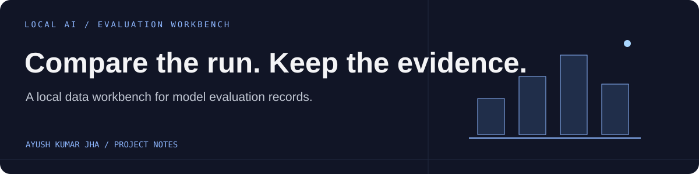

# Local AI Evaluation Workbench



Test the language models running on your own computer against your own prompts, then compare which one gets the job done, how fast, and how reliably. Prompts and answers never leave your machine.

## Open the app

**https://ayushkjha.github.io/Local-AI-Evaluation-Workbench/**

It talks to [Ollama](https://ollama.com) on your computer. Ollama only accepts pages it trusts, so start it with this site allowed:

```powershell
$env:OLLAMA_ORIGINS="https://ayushkjha.github.io"; ollama serve
```

On macOS or Linux: `OLLAMA_ORIGINS="https://ayushkjha.github.io" ollama serve`. If the browser asks to let the site reach devices on your local network, allow it. Running the page from `localhost` needs no extra setting.

## How it works

1. **Connect** to Ollama and tick the models to compare.
2. **Write test cases:** a prompt, an optional system prompt, and one or more checks the answer must pass.
3. **Run** every case on every selected model, one model at a time so it stays loaded.
4. **Compare** pass rate, average and p95 latency, and tokens per second, then open any cell to read the exact answer and see which check failed.

| Check | Passes when the answer… |
| --- | --- |
| Contains / Does not contain | includes (or avoids) a phrase, ignoring case |
| Matches regex | matches a regular expression |
| Equals exactly | is exactly the expected text |
| Is valid JSON | parses as JSON (code fences are allowed) |
| At most / At least N words | stays within a word count |

Reasoning models such as qwen3 and deepseek-r1 are scored on their final answer, not their thinking.

## Features

- Starter suite of five cases (extraction, JSON, length limit, reasoning, refusing to invent) to try in one click.
- Import cases from CSV (`name,prompt,type,value`, one row per check) or JSON.
- Temperature control, cancel mid-run, and the last 30 runs kept for comparison.
- Export results as CSV, or the whole workbench as JSON.
- Works on phones and follows your light or dark theme.

## Develop

Requires Node.js 22 or newer.

```sh
npm test
```

Scoring and the Ollama client live in [docs/lib/evals.js](docs/lib/evals.js) and are unit-tested without a browser. To run the page locally, serve `docs/` with any static server, for example `python -m http.server --directory docs`.

## Earlier record-keeping server

`server.mjs` is the original version: a small Node.js server that stores dataset and comparison records in SQLite under `data/`. It does not run models. Start it with `node server.mjs` (Node.js 24 or newer).
