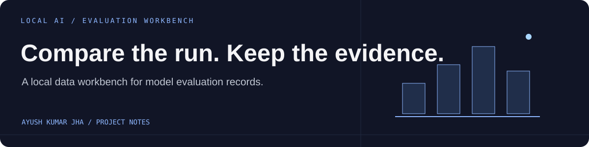

# Local AI Evaluation Workbench



A small local workspace for organizing AI evaluation datasets, recording model comparisons, and keeping report records together.

**Node.js 24+ · SQLite · Vanilla JavaScript**

## What is implemented

- Create, search, edit, and delete typed dataset, comparison, and report records.
- Import records from CSV or JSON and export JSON.
- Store application records in a local SQLite database.
- Run the built-in acceptance checks with `npm test`.

## Run locally

```sh
npm start
```

Open [http://127.0.0.1:4320](http://127.0.0.1:4320).

No npm packages or build step are needed. The database is created at `data/app.sqlite`; back up that directory if you want to preserve records.

## Current scope

This repository currently manages evaluation records. It does **not** run prompts against local models or automatically measure quality, latency, or cost yet. The repository does not include a public deployment. The app is designed for one local owner.

To expose the server on a network, configure `HOST=0.0.0.0`, set a strong `APP_PASSWORD` (at least 16 characters), use HTTPS, and provide durable storage for SQLite.

## Built with

Node.js built-in HTTP server and SQLite, with a browser interface in `workspace.html`, `workspace.css`, and `workspace.js`.
